# Atomic-Habits

A dark frosted-glass habit tracker, daily checklist, analytics suite, customizable notification engine, and native Android home-screen widget companion built with **Flutter** and **Kotlin**.

**Current Version:** `1.2.0` (`version: 1.2.0+2`)  
**Developer:** `saisriram Sr`  
**Privacy Policy:** [PRIVACY_POLICY.md](https://github.com/radhashankar38-ai/Atomic-Habits/blob/main/PRIVACY_POLICY.md)

## One-Click Download & Install (`v1.2.0`)

[](https://github.com/radhashankar38-ai/Atomic-Habits/raw/main/Atomic-Habits.apk)
[](https://github.com/radhashankar38-ai/Atomic-Habits/raw/main/Atomic-Habits-Source.tar.gz)

| File | Size | Direct One-Click Download |
| :--- | :--- | :--- |
| **Android Installer (`.apk`)** | `51.8 MB` | [Download `Atomic-Habits.apk`](https://github.com/radhashankar38-ai/Atomic-Habits/raw/main/Atomic-Habits.apk) |
| **Source Code Archive (`.tar.gz`)** | `308 KB` | [Download `Atomic-Habits-Source.tar.gz`](https://github.com/radhashankar38-ai/Atomic-Habits/raw/main/Atomic-Habits-Source.tar.gz) |

> **Install on Android:** Tap **Download `Atomic-Habits.apk`** above (downloads directly—no file preview page), then open the downloaded APK and tap **Install**.

---

## Features

### Habit Tracking & Streaks
- **Activity Rings Home View:** Multi-ring progress visualization with category filters (`Health`, `Work`, `Learning`, `Productivity`, `Personal`, `Fitness`, `Finance`, `Social`), instant haptic feedback, and smooth animations (`BouncingScrollPhysics` & `AppMotion` curves).
- **Quadratic Streak Formula & Recovery Lock:** Tracks consecutive streaks (`ceil(n² / 2)` points scaling), missed-day cooldown tracking, reflection notes, and customizable target day goals (`targetDays`).
- **Habit Details & Management:** Dedicated modal for live streak stats, instructions/notes, edit, reset, or delete.
- **Public-Domain Daily Motivation:** Displays a daily inspirational quote with public-domain offline fallback quotes (Lao Tzu, Marcus Aurelius, Epictetus, Seneca, Benjamin Franklin) and one-tap share/refresh.

### Daily To-Do Checklists & Time Reminders
- **Task Reminder Times:** Attach an optional daily reminder time (`HH:mm`, displayed as `9:30 AM`) to any To-Do task using the frosted glass time picker (`showGlassTimePicker`).
- **Long-Press Editing:** Long-press any task inside the **To-Do** sheet to edit the task text, update/clear its reminder time, or delete it.
- **Swipe-to-Delete & Toggle:** Smooth horizontal swipe gesture to reveal the delete action and bounce-animated completion checkboxes.

### Customizable Daily Notifications (Android Native)
- **In-Settings Customization (`Settings > Notifications`):**
  - Choose daily alert frequency (`1×`, `2×`, `3×`, or `4×` times per day).
  - Customize the exact trigger time for every daily slot via the frosted glass time picker.
  - Independently toggle alerts for **Habits** and **To-Do Tasks**.
  - **Test** button inside Settings to request Android 13+ notification permissions (`POST_NOTIFICATIONS`) and trigger preview notifications immediately.
- **Three Notification Styles (`AlarmManager` + `BootReceiver`):**
  1. **Daily Habits Reminder:** Summarizes pending active habits for the day and deep-links to Home.
  2. **Daily To-Do Check-In:** Summarizes incomplete checklist items and their reminder times, deep-linking to To-Do.
  3. **Per-Task Timed Reminder:** Fires individually at a task's set `reminderTime` with an inline **Mark Done** action button and direct editor deep-link.

### Native Android Home Screen Widgets (4 Widgets)
1. **Habit Rings Widget (`HabitRingsWidgetProvider`):** Interactive paged concentric progress rings (`<` / `>`) showing habit completion progress and categories with two-way sync back to Flutter.
2. **Daily Motivation Widget (`MotivationWidgetProvider`):** Live daily quote card with instant refresh cycle.
3. **To-Do List Widget (`TodoWidgetProvider` + `TodoWidgetService`):** Scrollable home-screen checklist showing each task's reminder time badge, completion toggle, `+` quick add button, and per-row **Edit** button deep-linking into that task's editor.
4. **Average Timing Widget (`TimingWidgetProvider`):** Interactive `WEEK` / `MONTH` / `YEAR` habit completion timing bar chart right on the home screen.

### Analytics, Badges & Certificates
- **Progress Tab:** Weekly ticks, hourly intensity heatmap dots, `WEEK` / `MONTH` / `YEAR` average timing bar chart, individual habit timing charts, and interactive monthly completion calendar.
- **Badges & Mastery Certificates:** Point accumulation, user ranks, global streak achievements, per-habit Bronze/Silver/Gold/Diamond tiers, confetti celebration, and exportable/shareable mastery certificates.

### Privacy, Data Ownership & Support
- **Offline-First Persistence & Backups:** Stores all habits, completions, reflections, checklists, and notification preferences locally via `SharedPreferences`; export/import full JSON backups anytime from Settings.
- **Support Developer:** Accessible inside Settings with an optional GPay / UPI QR code sheet (`Share QR`).

---

## Screenshots

### Core Experience
| Home & Rings | Add Habit | Progress & Timing | Progress Calendar |
| :---: | :---: | :---: | :---: |
| 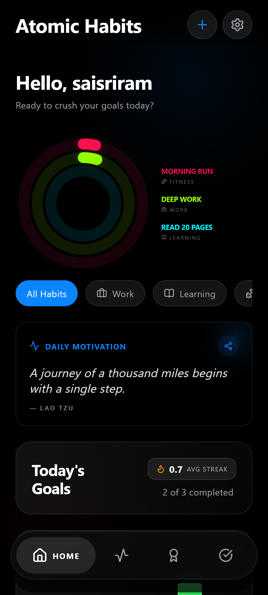 | 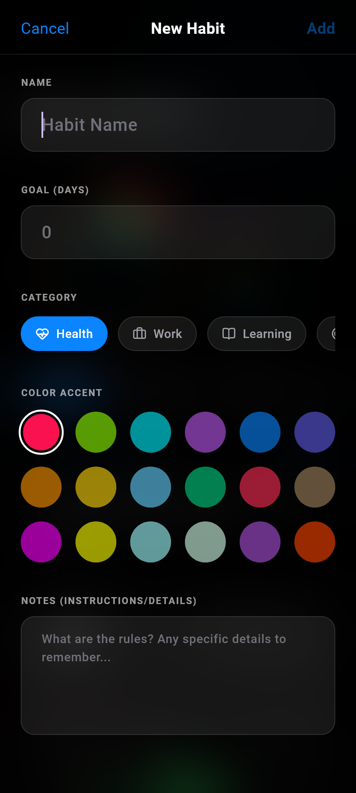 | 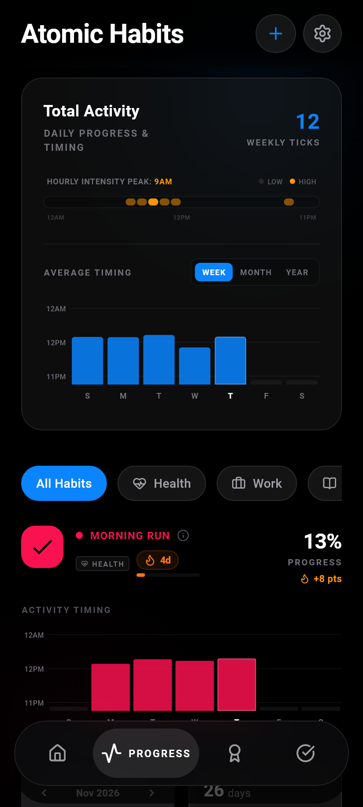 | 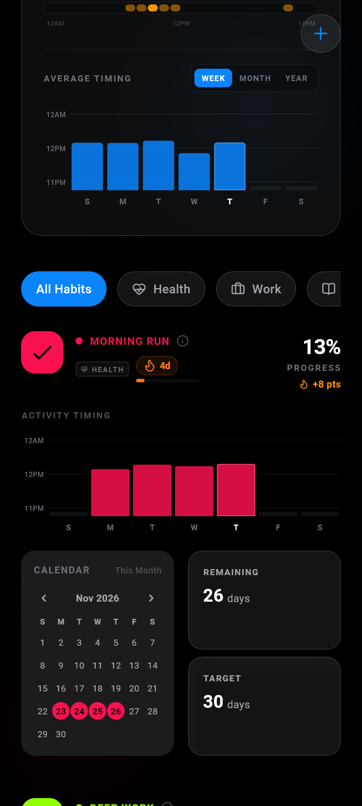 |

| Habit Detail | Badges & Points | Mastered Habits | Mastery Certificate |
| :---: | :---: | :---: | :---: |
| 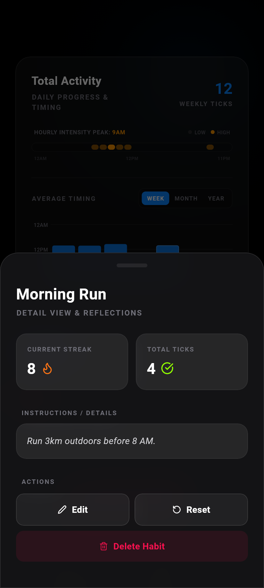 | 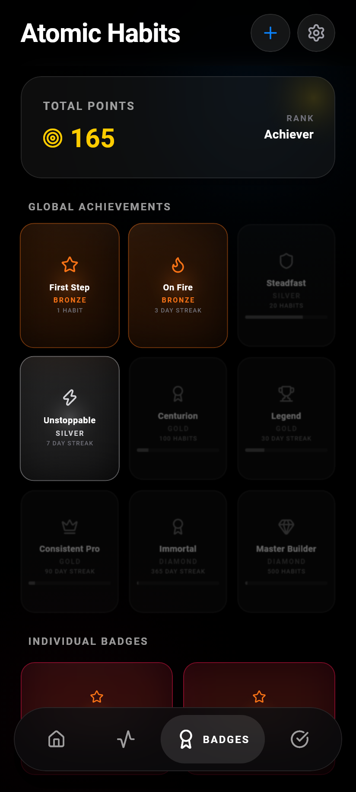 | 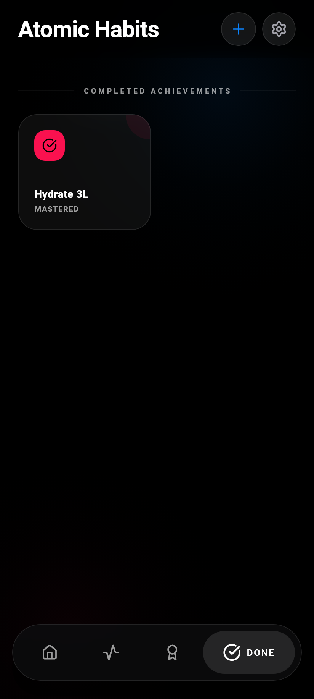 | 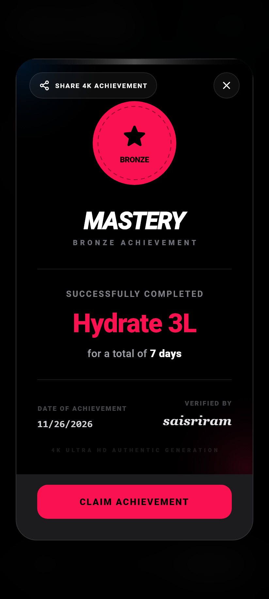 |

### To-Do Reminders, Settings Customization & Notifications
| To-Do Long-Press Edit & Reminder | Settings Notification Controls | Android Notification Styles (Preview) |
| :---: | :---: | :---: |
| 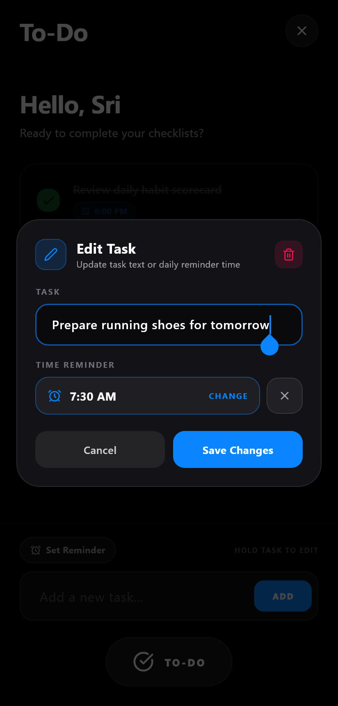 | 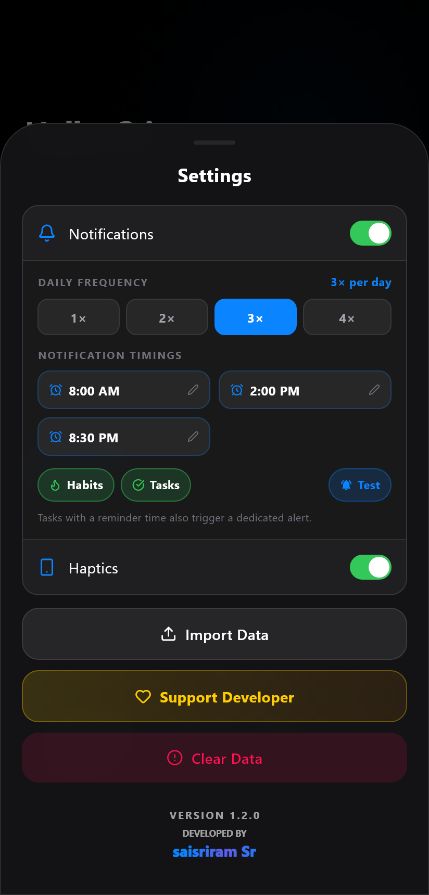 | 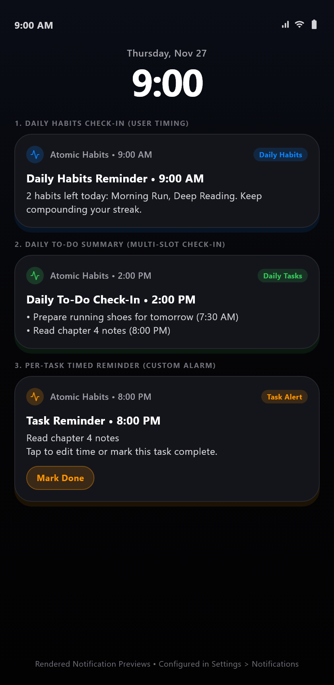 |

### Android Home Screen Widgets (Rendered Previews)
| Rings & Motivation Widgets | To-Do Reminder & Average Timing Widgets |
| :---: | :---: |
| 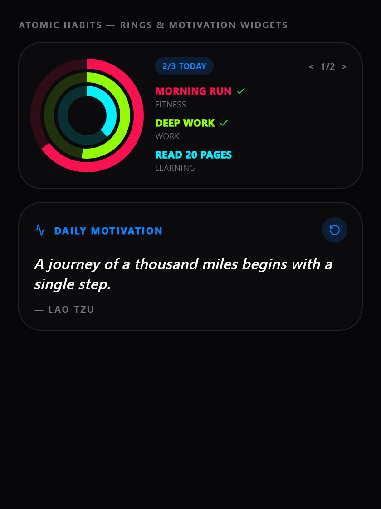 | 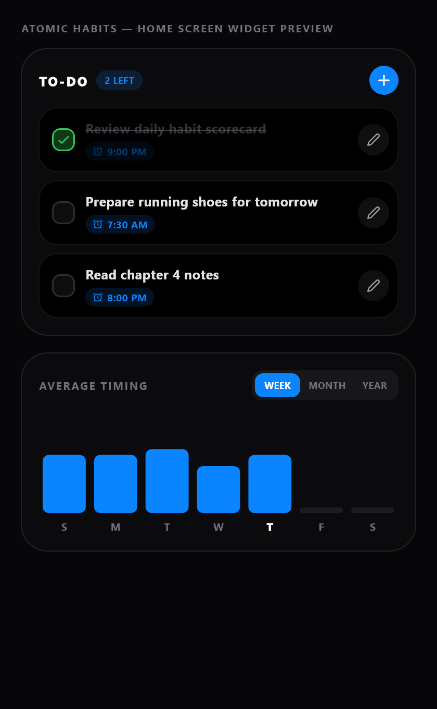 |

---

## Repository Structure

```text
atomic-habits/
├── flutter_app/                  # Main Flutter + Kotlin Android mobile application (v1.2.0)
│   ├── lib/
│   │   ├── constants/            # App colors, categories, badge rules
│   │   ├── modals/               # Settings tray, time picker, habit add/edit, details, certificates
│   │   ├── models/               # Habit, TodoModel (with reminderTime), stats models
│   │   ├── screens/              # Home, Progress, Badges, Done, To-Do, MainShell
│   │   ├── state/                # HabitStore & Android widget/notification bridge
│   │   └── widgets/              # Glass UI primitives, activity rings, charts, animations
│   ├── android/app/src/main/     # Kotlin AppWidgetProviders, RemoteViewsService, NotificationScheduler
│   └── test/                     # Unit and interactive widget tests
├── screenshots/                  # App, widget, and notification preview screenshots
├── src/                          # Original React/Vite web prototype
└── README.md
```

---

## Building & Testing (`flutter_app`)

```bash
cd flutter_app
flutter pub get
flutter analyze
flutter test
flutter build apk --release
```
